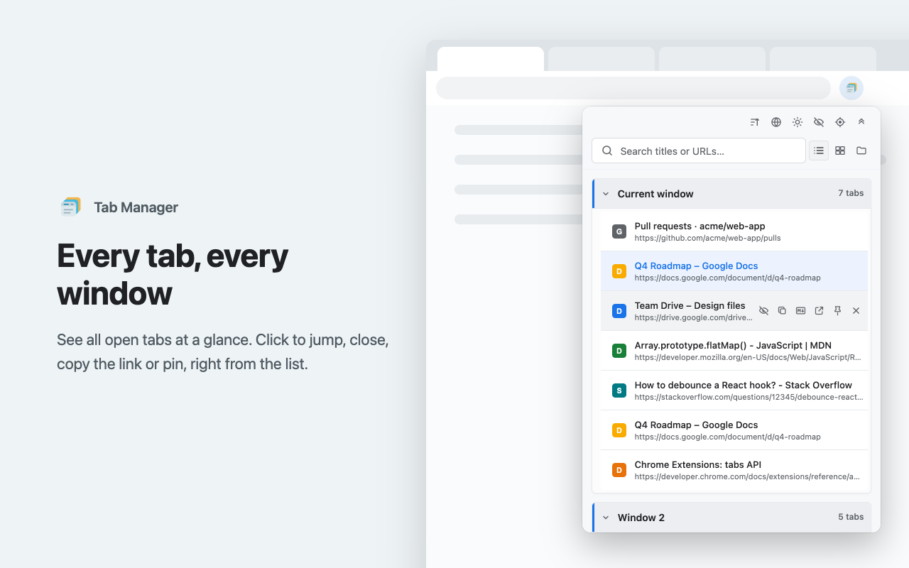
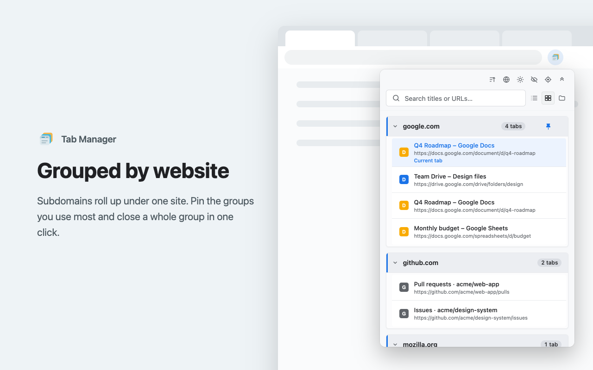
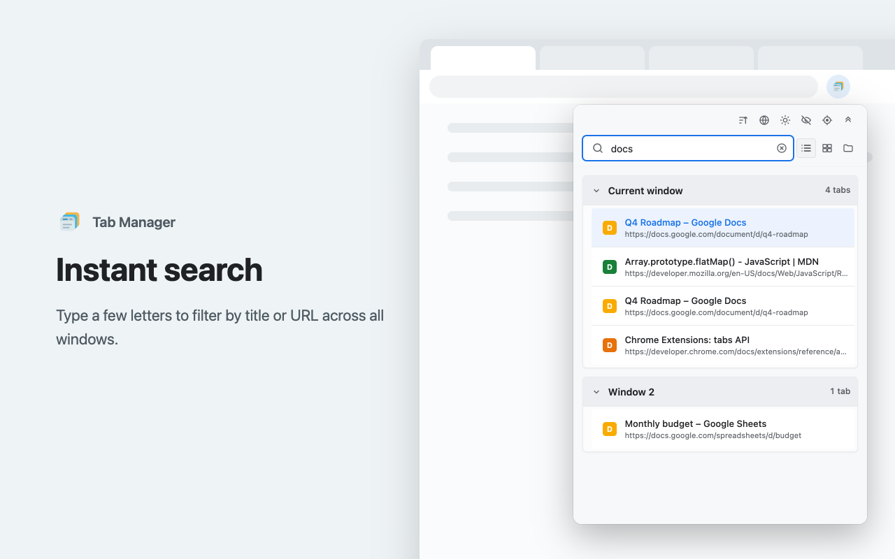
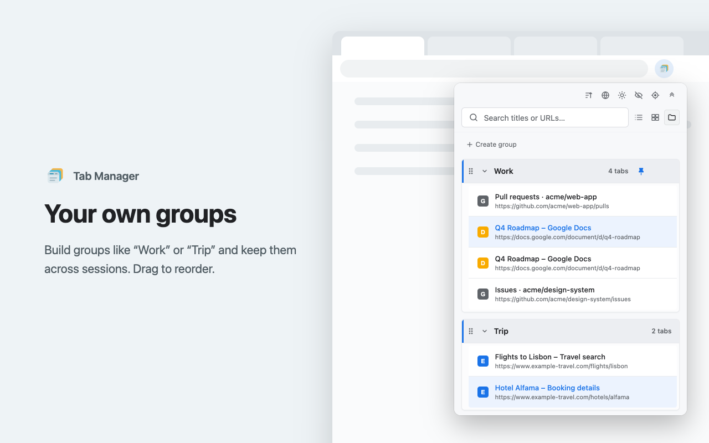
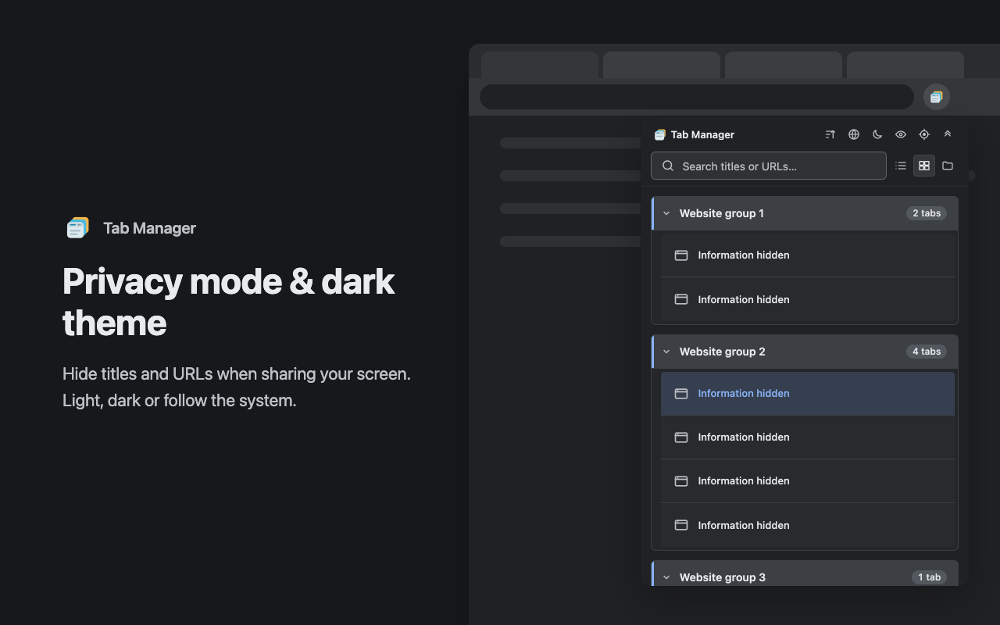

# Chrome Tab Manager

English | [简体中文](README.zh-CN.md) | [繁體中文](README.zh-TW.md)

A compact local Chrome extension for finding and managing many open tabs from a toolbar popup without taking space from the current webpage.

## Features

- Search tab titles and URLs across every window.
- Click a tab to focus it, or close tabs directly from the popup.
- Move a tab out into a new window of its own with one click.
- Stay synchronized as tabs and windows are created, updated, moved, activated, or closed.
- Switch between a window list, registrable-domain groups, and your own custom groups. Subdomains such as `docs.google.com` and `drive.google.com` are grouped under `google.com`.
- Pin tabs and groups to the top, remove duplicates, and sort a window's tabs by domain.
- Hide sensitive tab information globally, by domain group, or per tab.
- Use a compact sticky toolbar with privacy, grouping, view, appearance (light / dark / system), and language controls.
- Use Simplified Chinese, Traditional Chinese, or English; the default follows the browser language (zh-TW / zh-HK / zh-MO / zh-Hant map to Traditional Chinese) and falls back to English.

## Screenshots

### Every tab, every window



The default list view shows every open tab grouped by window, current window first. Click a tab to jump to it; hover it to hide, copy the link, copy as Markdown, open it in a new window, pin, or close it.

### Grouped by website



Use the grid button next to the search box to switch to the domain view. Subdomains roll up under one site; pin the groups you use most, hide a whole group, or close every tab in it at once.

### Instant search



Type in the search box to filter by title or URL across all windows as you type.

### Your own groups



Open the folder view to create groups such as "Work" or "Trip", tick the tabs that belong in each one, then rename, pin, or drag the groups to reorder them. Groups are kept between sessions.

### Privacy mode & dark theme



The eye button in the toolbar hides every title, URL, and icon — handy when sharing your screen. The sun button switches between light, dark, and follow-the-system appearance.

## Requirements

- Chrome 141 or later
- Node.js and npm

## Build

```bash
npm install
npm test
npm run lint
npm run build
```

The unpacked production extension is generated in `dist`.

## Load in Chrome

1. Open `chrome://extensions`.
2. Enable **Developer mode**.
3. Select **Load unpacked** and choose `<project-directory>/dist`.
4. Click the extension icon in the Chrome toolbar to open the popup.

The popup closes automatically when it loses focus and does not reduce the webpage's available width.

## Privacy and Permissions

Tab information is visible by default. Everything the extension stores stays in its own `localStorage` on your computer; it is not synced to your Google account, is never sent anywhere, and is removed when you uninstall the extension. That includes:

- preferences: global privacy setting, view mode, language, and appearance;
- the URLs of tabs you add to a custom group, and the names of your custom groups;
- pinned tabs and domains, and the tab order saved before sorting by domain (numeric tab IDs).

Search text and per-tab or per-group privacy overrides live only for the current popup instance. Titles and favicons of open tabs are read only while the popup is open and are not saved. See the [privacy policy](store-assets/privacy-policy.md) for details.

The extension makes no network requests and sends no browsing data to a remote service. It requests the `tabs`, `favicon` and `clipboardWrite` permissions, plus `scripting` with optional site access (`optional_host_permissions: <all_urls>`) for "Copy as Markdown". Site access is only requested the first time that button is used. The page's current HTML is read by a read-only script injected on click and converted to Markdown locally, with no network request.
