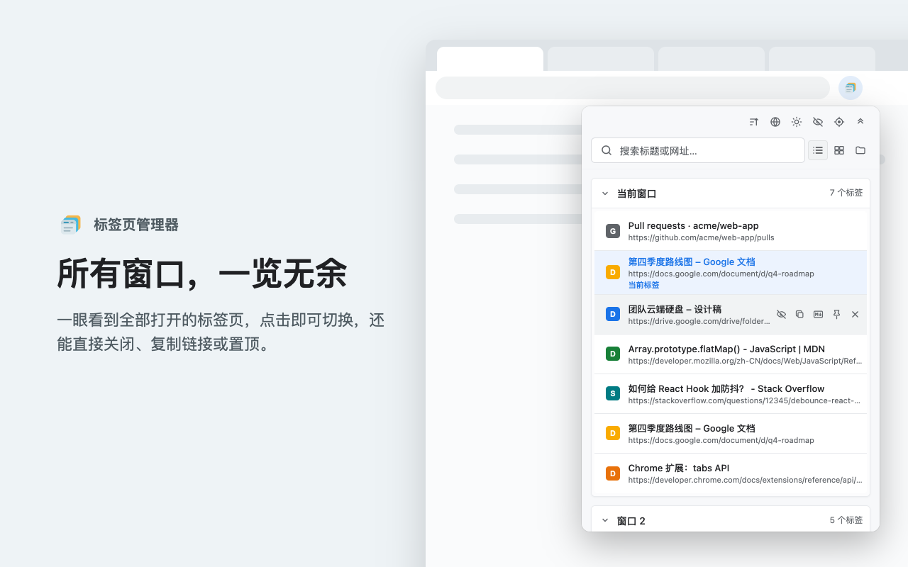
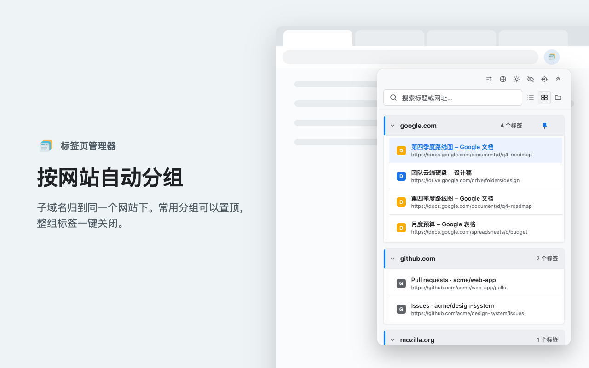
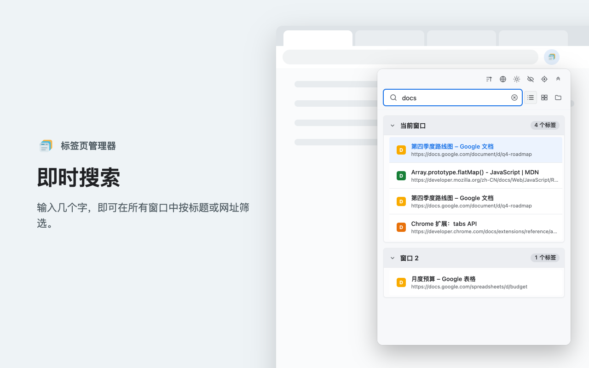
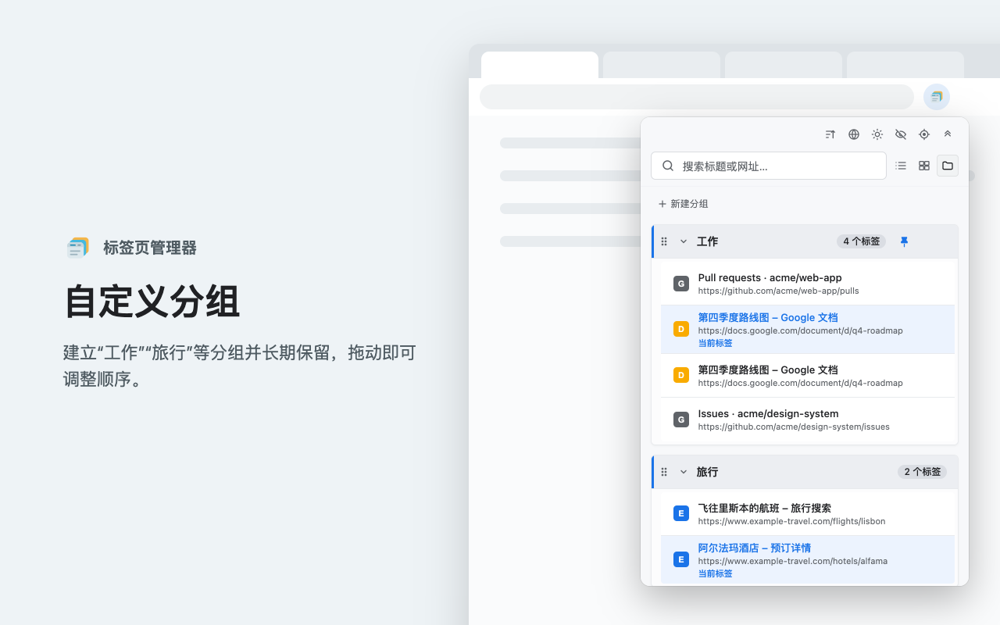
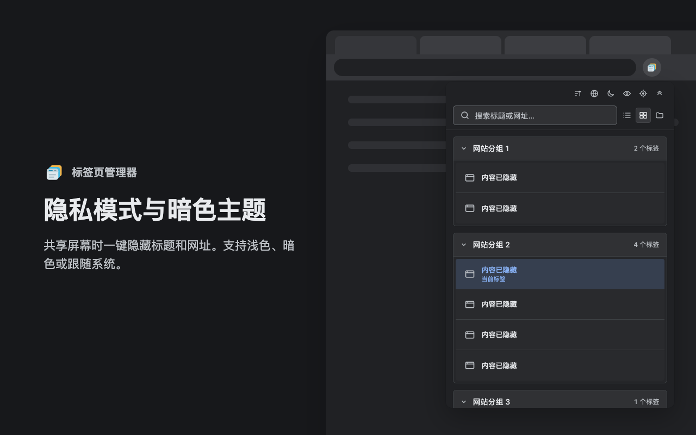

# Chrome 标签页管理器

[English](README.md) | 简体中文 | [繁體中文](README.zh-TW.md)

一个使用 Chrome 工具栏 Popup 的本地标签页管理扩展。点击扩展图标即可搜索、筛选、切换和关闭大量标签页；弹窗失去焦点后由 Chrome 自动关闭，不占用当前网页的显示宽度。

## 核心功能

- 搜索标签页标题和 URL。
- 点击标签页切换并聚焦所属窗口，或直接关闭标签页。
- 一键把标签页移到一个新窗口中打开。
- 标签页和窗口创建、更新、移动、激活或关闭时实时同步。
- 在按窗口排列的列表视图、按可注册主域名排列的分组视图和自定义分组视图之间切换。
- 子域名统一归入主域名，例如 `docs.google.com`、`drive.google.com`、`www.google.com` 和 `xaa.bac.google.com` 都归入 `google.com`。
- 支持全局、域名分组和单标签页隐私隐藏；隐藏时不显示标题、URL 和 favicon。
- 分组模式支持整组隐藏、整组关闭，以及一键折叠或展开全部分组。
- 支持置顶标签页和分组、移除重复标签页，以及按域名排序窗口内的标签页。
- 点击弹窗左上角的扩展图标和名称，打开它的 [Chrome 应用商店页面](https://chromewebstore.google.com/detail/tab-manager/jnlddbkjimakfiglopimemjlabocnhag)。
- 紧凑工具栏、滚动时搜索框渐进吸顶、浅色 / 暗色 / 跟随系统外观，以及简体中文 / 繁体中文 / 英文界面。

## 产品截图

### 所有窗口，一览无余



默认的列表视图按窗口列出所有打开的标签页，当前窗口排在最前。点击标签页即可切换过去；鼠标悬停时可以隐藏、复制链接、复制为 Markdown、在新窗口中打开、置顶或关闭。

### 按网站自动分组



点击搜索框右侧的网格按钮切换到域名分组视图。子域名归到同一个网站下；常用分组可以置顶，也可以整组隐藏或一键关闭整组标签页。

### 即时搜索



在搜索框中输入几个字，即可在所有窗口中按标题或网址实时筛选。

### 自定义分组



点击文件夹按钮进入自定义分组视图，新建“工作”“旅行”等分组，勾选要放进去的标签页，并可重命名、置顶或拖动调整顺序。分组在关闭浏览器后依然保留。

分组按网址记住其中的页面：无论在标签栏、其他窗口还是在行上的关闭按钮关掉标签页，它都会留在分组里，置灰并标记“未打开”。点击分组里的一项，已打开就直接切换过去，未打开就用保存的网址新开一个标签页；浏览器重启后也会按网址重新匹配已打开的标签页。行上的“移出分组”按钮把这一项从分组中移除。分组标题行的关闭按钮会删除分组并关闭其中已打开的标签页；垃圾桶按钮只删除分组，保留标签页。

### 隐私模式与暗色主题



工具栏上的眼睛按钮一键隐藏所有标题、网址和图标，共享屏幕时更安心；太阳按钮可在浅色、暗色和跟随系统外观之间切换。

## 界面与状态

- 首次打开时标签页信息默认可见。
- 默认使用列表视图，也可以切换到域名分组视图或自定义分组视图。
- 顶部地球图标可选择自动、简体中文、繁體中文或 English。自动模式跟随浏览器语言（zh-TW / zh-HK / zh-MO / zh-Hant 匹配繁体中文，其余中文匹配简体中文），不支持的语言回退到英文。
- 全局隐私状态、视图模式、语言和外观偏好保存在本地，下次打开 Popup 时恢复；置顶和自定义分组也会保留。
- 搜索文字、单标签页和分组隐私覆盖只存在于当前 Popup 实例，关闭 Popup 后清除。

## 环境要求

- Chrome 141 或更高版本
- Node.js 和 npm

## 安装、测试与构建

在项目根目录运行：

```bash
npm install
npm test
npm run lint
npm run build
```

生产扩展生成在 `dist` 目录。

## 在 Chrome 中加载

1. 运行 `npm run build`。
2. 打开 `chrome://extensions`。
3. 开启**开发者模式**。
4. 点击**加载已解压的扩展程序**。
5. 选择 `<项目目录>/dist`。
6. 点击 Chrome 工具栏中的扩展图标打开标签页管理 Popup。

点击弹窗外部、切换窗口或按 Escape 后，Chrome 会关闭 Popup；网页可始终使用完整显示区域。

## 隐私处理

隐藏状态下，对应标签页的原始标题、URL 和 favicon 不会出现在可见内容或相关无障碍文本中。搜索与筛选仍可使用内存中的标签数据，但匹配项只显示通用占位内容；当整个域名分组均被隐藏时，组名也会隐藏。

顶部眼睛图标切换全局隐私状态，并清除已有的单标签页覆盖，使所有标签页重新服从全局设置。每个标签页和域名分组也有独立的隐私按钮，但这些覆盖不会持久化，从而避免 Chrome 复用 Tab ID 时误用旧设置。

扩展保存的所有数据都只存放在本机扩展自己的 `localStorage` 中，不会同步到 Google 账号，也不会发送到任何地方，卸载扩展时一并删除。保存的内容包括：

- 偏好设置：全局隐私开关、视图模式、语言和外观；
- 你加入自定义分组的标签页网址及其最近一次的页面标题（让未打开的项仍可辨认），以及自定义分组名称；
- 置顶的标签页和域名，以及按域名排序前的标签顺序（数字 ID）。

已打开标签页的标题和 favicon 只在 Popup 打开期间于内存中使用，不会保存（自定义分组里标签页的标题除外）；搜索内容和单项隐私覆盖也不会持久化。扩展不发出任何网络请求，不会向远程服务发送浏览数据。详见[隐私政策](store-assets/privacy-policy.zh-CN.md)。

## 权限

- `tabs`：读取标签页和窗口信息，并执行切换、聚焦、移到新窗口与关闭操作。
- `favicon`：安全使用 Chrome 提供的本地图标资源。
- `clipboardWrite`：复制标签链接和 Markdown 内容。
- `scripting` + 可选的网站访问权限（`optional_host_permissions: <all_urls>`）：仅用于"复制为 Markdown"。第一次点击该按钮时才请求网站访问权限，安装时不申请；授权后，只在点击时向对应标签页注入一段只读脚本，读取页面当前的 HTML。HTML 在扩展内本地转换为 Markdown，不发起任何网络请求。
- 不声明固定的 `host_permissions`。

## 构建安全

扩展页面使用严格 Content Security Policy，仅加载扩展包内资源和允许的内联图片数据。构建流程会检查最终 `dist` 中的 manifest、HTML、CSS、JavaScript、XML/SVG 和图标资源，拒绝远程可加载资源、路径逃逸和未知二进制文件。
