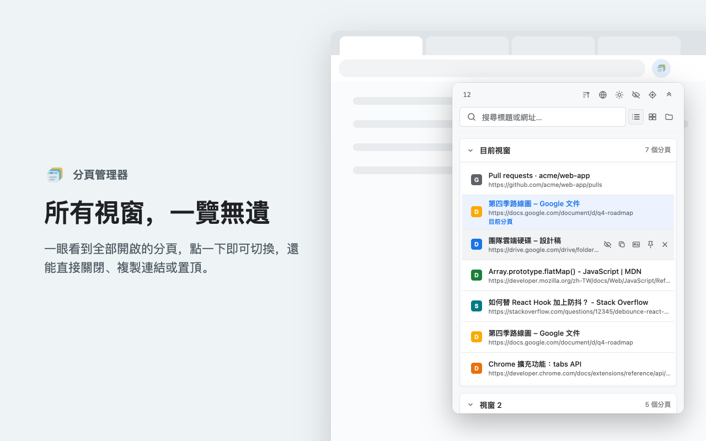
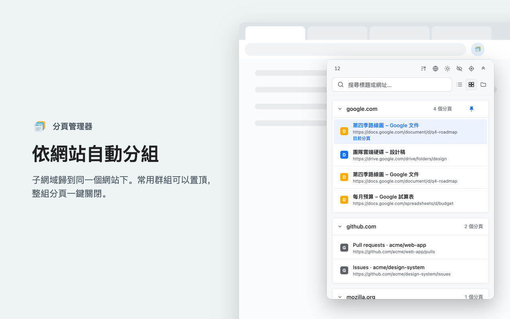
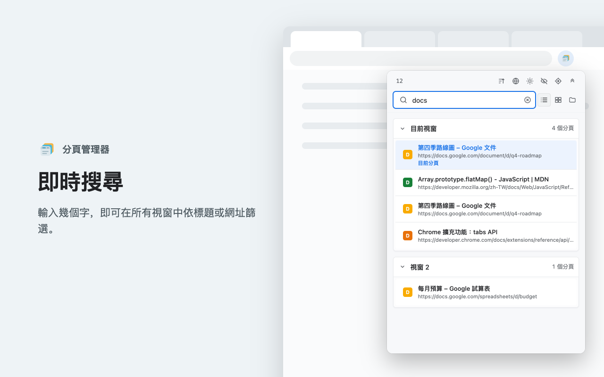
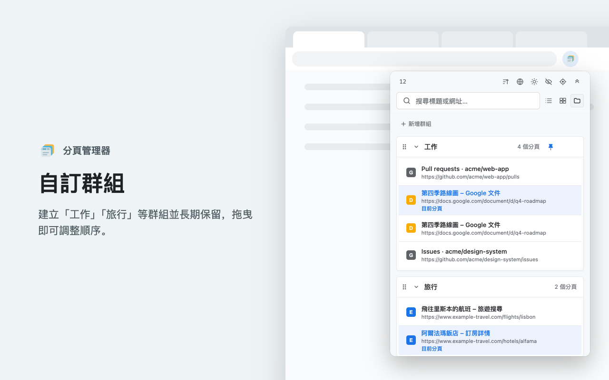
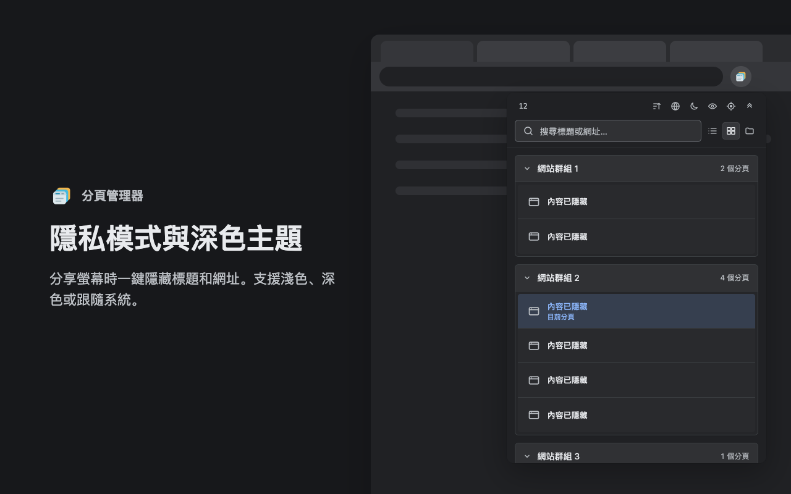

# Chrome 分頁管理器

[English](README.md) | [简体中文](README.zh-CN.md) | 繁體中文

一個使用 Chrome 工具列彈出視窗（Popup）的本機分頁管理擴充功能。點選擴充功能圖示即可搜尋、篩選、切換和關閉大量分頁；彈出視窗失去焦點後由 Chrome 自動關閉，不佔用目前網頁的顯示寬度。

## 核心功能

- 搜尋分頁標題和網址。
- 點選分頁即可切換並聚焦所屬視窗，或直接關閉分頁。
- 分頁和視窗建立、更新、移動、啟用或關閉時即時同步。
- 在依視窗排列的清單檢視、依可註冊主網域排列的網域分組檢視和自訂群組檢視之間切換。
- 子網域統一歸入主網域，例如 `docs.google.com`、`drive.google.com`、`www.google.com` 和 `xaa.bac.google.com` 都歸入 `google.com`。
- 支援全域、網域群組和單一分頁的隱私隱藏；隱藏時不顯示標題、網址和 favicon。
- 分組模式支援整組隱藏、整組關閉，以及一鍵收合或展開全部群組。
- 支援置頂分頁和群組、移除重複分頁，以及依網域排序視窗內的分頁。
- 精簡工具列、捲動時搜尋框漸進固定在頂端、淺色 / 深色 / 跟隨系統外觀，以及简体中文 / 繁體中文 / English 介面。

## 產品截圖

### 所有視窗，一覽無遺



預設的清單檢視依視窗列出所有開啟的分頁，目前視窗排在最前面。點選分頁即可切換過去；滑鼠游標停在分頁上時，可以隱藏、複製連結、複製為 Markdown、置頂或關閉。

### 依網站自動分組



點選搜尋框右側的格狀按鈕切換到網域分組檢視。子網域會歸到同一個網站下；常用群組可以置頂，也可以整組隱藏或一鍵關閉整組分頁。

### 即時搜尋



在搜尋框中輸入幾個字，即可在所有視窗中依標題或網址即時篩選。

### 自訂群組



點選資料夾按鈕進入自訂群組檢視，新增「工作」「旅行」等群組，勾選要放進去的分頁，並可重新命名、置頂或拖曳調整順序。群組在關閉瀏覽器後依然保留。

### 隱私模式與深色主題



工具列上的眼睛按鈕可一鍵隱藏所有標題、網址和圖示，分享螢幕時更安心；太陽按鈕可在淺色、深色和跟隨系統外觀之間切換。

## 介面與狀態

- 第一次開啟時，分頁資訊預設為可見。
- 預設使用清單檢視，也可以切換到網域分組檢視或自訂群組檢視。
- 頂端地球圖示可選擇自動、简体中文、繁體中文或 English。自動模式跟隨瀏覽器語言（zh-TW / zh-HK / zh-MO / zh-Hant 對應繁體中文，其餘中文對應簡體中文），不支援的語言改用英文。
- 全域隱私狀態、檢視模式、語言和外觀偏好儲存在本機，下次開啟彈出視窗時還原；置頂和自訂群組也會保留。
- 搜尋文字、單一分頁和群組的隱私覆寫只存在於目前的彈出視窗，關閉後即清除。

## 環境需求

- Chrome 141 或更新版本
- Node.js 和 npm

## 安裝、測試與建置

在專案根目錄執行：

```bash
npm install
npm test
npm run lint
npm run build
```

正式版擴充功能會產生在 `dist` 目錄。

## 在 Chrome 中載入

1. 執行 `npm run build`。
2. 開啟 `chrome://extensions`。
3. 開啟**開發人員模式**。
4. 點選**載入未封裝項目**。
5. 選擇 `<專案目錄>/dist`。
6. 點選 Chrome 工具列中的擴充功能圖示，開啟分頁管理彈出視窗。

點選彈出視窗外部、切換視窗或按下 Escape 後，Chrome 會關閉彈出視窗；網頁始終可以使用完整的顯示區域。

## 隱私處理

隱藏狀態下，對應分頁的原始標題、網址和 favicon 不會出現在可見內容或相關的無障礙文字中。搜尋與篩選仍可使用記憶體中的分頁資料，但符合的項目只顯示通用的預留內容；當整個網域群組都被隱藏時，群組名稱也會隱藏。

頂端的眼睛圖示切換全域隱私狀態，並清除既有的單一分頁覆寫，讓所有分頁重新依照全域設定。每個分頁和網域群組也有獨立的隱私按鈕，但這些覆寫不會保存，以免 Chrome 重複使用分頁 ID 時誤套舊設定。

擴充功能保存的所有資料都只存放在本機擴充功能自己的 `localStorage` 中，不會同步到 Google 帳戶，也不會傳送到任何地方，移除擴充功能時會一併刪除。保存的內容包括：

- 偏好設定：全域隱私開關、檢視模式、語言和外觀；
- 你加入自訂群組的分頁網址，以及自訂群組名稱；
- 置頂的分頁和網域，以及依網域排序前的分頁順序（數字 ID）。

已開啟分頁的標題和 favicon 只在彈出視窗開啟期間於記憶體中使用，不會保存；搜尋內容和單一項目的隱私覆寫也不會保存。擴充功能不發出任何網路請求，不會把瀏覽資料傳送到遠端服務。詳見[隱私權政策](store-assets/privacy-policy.md)。

## 權限

- `tabs`：讀取分頁和視窗資訊，並執行切換、聚焦與關閉操作。
- `favicon`：安全地使用 Chrome 提供的本機圖示資源。
- `clipboardWrite`：複製分頁連結和 Markdown 內容。
- `scripting` + 選用的網站存取權（`optional_host_permissions: <all_urls>`）：僅用於「複製為 Markdown」。第一次點選該按鈕時才要求網站存取權，安裝時不要求；授權後，只在點選時對該分頁注入一段唯讀指令碼，讀取頁面目前的 HTML。HTML 在擴充功能內於本機轉換為 Markdown，不發出任何網路請求。
- 不宣告固定的 `host_permissions`。

## 建置安全

擴充功能頁面使用嚴格的內容安全政策（Content Security Policy），只載入擴充功能套件內的資源和允許的內嵌圖片資料。建置流程會檢查最終 `dist` 中的 manifest、HTML、CSS、JavaScript、XML/SVG 和圖示資源，拒絕可從遠端載入的資源、路徑逃逸和不明的二進位檔案。
